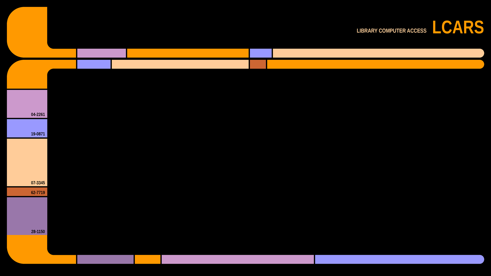

# LCARS

A Star Trek LCARS-style desktop theme. An unofficial fan project.



## Layout

```
palette/lcars.json   The colours and fonts every target should use
targets/<name>/      One directory per app, mirroring its config directory
install.sh           Symlinks targets into place
```

Targets are organised by app rather than by OS, because many apps (kitty,
VS Code) run on several systems. `install.sh` decides which targets apply to
each OS.

| Target | Installs to | Contents |
| --- | --- | --- |
| `sway` | `~/.config/sway` | Window colours, i3 keybindings, status bar, wallpaper, helper scripts |
| `swaynag` | `~/.config/swaynag` | Dialog colours |
| `foot` | `~/.config/foot` | Terminal colours |
| `kitty` | `~/.config/kitty` | Terminal colours (`lcars.conf`) |
| `glow` | `~/.config/glow` | Markdown style (`lcars.json`), in glamour's JSON format |
| `doom` | `~/.config/doom` | Doom Emacs theme (`themes/doom-lcars-theme.el`) and an Org writing `.dir-locals.el`; see [its README](targets/doom/README.md) |
| `vscode` | VS Code extension | Colour theme; see [its README](targets/vscode/README.md) |

## Install

```sh
./install.sh -n          # dry run for this OS's default targets
./install.sh             # install them
./install.sh kitty       # install one target
```

`install.sh` handles every target above except `vscode`, which has its own steps.

Files are symlinked, so edits in this repo take effect directly. Anything
already in place is kept as `<file>.bak-<timestamp>`.

The kitty target only adds the colour file. To use it, add
`include ./lcars.conf` to `kitty.conf`, then reload with `ctrl+shift+f5`.

The glow target also only adds the style file. To use it, set
`style: "/home/<you>/.config/glow/lcars.json"` in `glow.yml`. The path must be
absolute, because glow reads it without expanding `~` or `$HOME`. When output
goes to a pipe, glow ignores this setting unless you give `-s`.

The doom target only adds the theme file. To use it, set
`(setq doom-theme 'doom-lcars)` in `config.el` and restart Emacs or run
`doom/reload-theme`.

## Sway dependencies

Required: `sway`, `swaybar`, `python3`, `foot`, `kitty`, `wmenu`,
`fonts-liberation`.

Optional: `swaylock`, `swayidle`, `grim`, `slurp`, `wl-clipboard`,
`nm-applet`, `htop`, `baobab`, `bluez`, `wireplumber`, `pulseaudio-utils`,
`power-profiles-daemon`, `gnome-control-center`.

To regenerate the wallpaper (needs Pillow):

```sh
targets/sway/scripts/wallpaper.py targets/sway/lcars.png
```

## Adding a target

1. Create `targets/<name>/` with the app's theme files, using colours from
   `palette/lcars.json`.
2. Add its destination to `dest()` in `install.sh`, and to the default list for
   each OS it supports. If it doesn't install by symlinking into a config
   directory, as with a VS Code extension, leave it out of `install.sh` and put
   the steps in `targets/<name>/README.md`.

Colours are currently copied into each target by hand, so a palette change
means updating each one.
